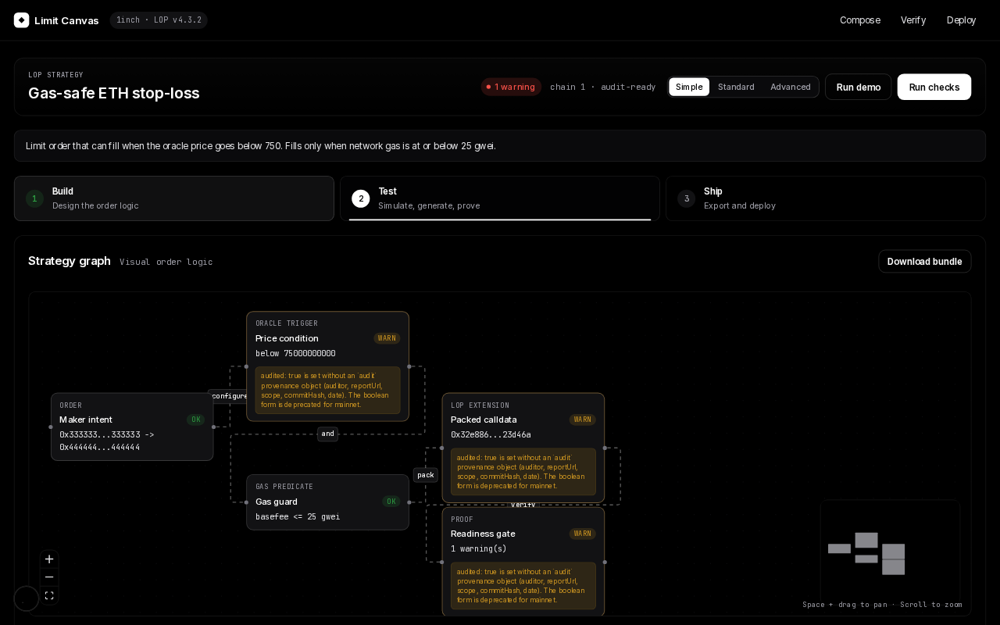

# Limit Canvas: a visual builder that turns 1inch limit-order strategies into tested Solidity

[](https://github.com/RahilBhavan/limit-canvas/actions/workflows/ci.yml) [](LICENSE)



Limit Canvas is a Bun monorepo for building extensions for the [1inch Limit Order Protocol](https://github.com/1inch/limit-order-protocol) (LOP), pinned to **v4.3.2**. You compose a strategy such as a stop-loss with a gas cap on a visual canvas. A Zod-validated DSL feeds a code generator that writes the Solidity, a deploy script and a deterministic `manifest.json`. Foundry tests then deploy the pinned LOP contract locally and fill orders that carry the generated extensions.

## What it does

LOP extensions are hard to get right by hand. You must pack the extension calldata with exact offsets, and the low 160 bits of the order `salt` must equal the low 160 bits of `keccak256(extension)`. If either is wrong, the order never fills. Limit Canvas does that encoding and proves it:

| Capability | Evidence |
| --- | --- |
| Generated extensions fill through pinned LOP 4.3.2 | [`LopFillIntegration.t.sol`](packages/contracts/test/integration/LopFillIntegration.t.sol) calls `lop.fillOrderArgs(...)` |
| Salt low 160 bits match `keccak256(extension)` | [`extension.test.ts`](packages/lop-sdk/src/extension.test.ts), mirrored in [`LopOrderTestLib.sol`](packages/contracts/test/helpers/LopOrderTestLib.sol) |
| The SDK builds LOP `and`, `or` and `not` predicates (codegen emits `and`) | [`predicates.ts`](packages/lop-sdk/src/predicates.ts) |
| LOP address checked against a registry of 10 chains (9 mainnets and Sepolia) | [`registry.ts`](packages/lop-sdk/src/registry.ts), shown as a readiness gate in the studio |
| The same DSL input produces byte-identical artifacts | `dslHash` in [`generate.ts`](packages/codegen/src/generate.ts), snapshots in [`examples.test.ts`](packages/codegen/src/examples.test.ts) |
| Stop-loss reverts on stale, incomplete or wrong-decimals oracle data | [`StopLossStrategy.t.sol`](packages/contracts/test/unit/StopLossStrategy.t.sol) and the integration fill tests |
| `manifest.bytecodeHash` is the keccak of compiled runtime bytecode, and CI fails if it drifts | [`snapshot-bytecode-hashes.ts`](packages/codegen/scripts/snapshot-bytecode-hashes.ts), [`ci.yml`](.github/workflows/ci.yml) |
| The codegen CLI refuses mainnet output unless the template is `audit-ready` and the DSL sets `audited: true` | [`cli.ts`](packages/codegen/src/cli.ts), [`preflight-panel.tsx`](apps/studio/src/components/preflight-panel.tsx) |

Four templates run end to end (DSL, Solidity, manifest and a Foundry fill test):

- `stop-loss`: an oracle price predicate with staleness, round-completeness and decimals checks.
- `gas-guard`: a base-fee cap predicate. The demo strategy is `AND(stop-loss, gas-guard)`.
- `twap-slice`: a time-windowed amount getter for partial fills. The generated bundle includes keeper-liveness notes.
- `dca-schedule`: a tranche series with an on-chain metadata registry and keeper notes.

Oracle band, deadline window, private taker and Dutch auction appear in the catalog as planned or research only. They do not generate code.

## How it works

A strategy moves through five workspace packages:

1. `apps/studio` is a Next.js 15 app. You build the strategy on a canvas, replay fill conditions in a simulation panel, generate the bundle and run `forge test` from the **Verify** page.
2. `packages/hook-dsl` defines the `StrategyDocument` Zod schema and the template catalog.
3. `packages/lop-sdk` packs extensions, derives the salt and holds the LOP address registry.
4. `packages/codegen` turns a DSL document into Solidity, a deploy script, a generated README and `manifest.json` (DSL hash, extension hash, LOP pin, bytecode hash).
5. `packages/contracts` holds the Foundry templates and a harness that deploys LOP 4.3.2 locally with mock oracles and tokens.

[`CODE_TOUR.md`](CODE_TOUR.md) walks through the five most important files.

## Run it

Prerequisites: [Bun](https://bun.sh) 1.x (tested with 1.4.0) and [Foundry](https://book.getfoundry.sh) (pinned to **forge 1.5.1**, the version CI installs and `.gas-snapshot` was generated on). Gas numbers change between Foundry releases: forge 1.8.6 reads 237,841 for the fill benchmark against 208,825 on 1.5.1, so `forge snapshot --check` fails on other versions. Clone with submodules so the pinned LOP, solidity-utils, OpenZeppelin and forge-std sources are present.

```bash
git clone --recurse-submodules https://github.com/RahilBhavan/limit-canvas.git
cd limit-canvas
bun install
bun run build:packages
```

Run the tests:

```bash
bun run test:packages   # 22 Bun tests across hook-dsl, lop-sdk and codegen
bun run test:contracts  # 34 Foundry tests: 17 unit, 11 integration, 1 fuzz, 5 benchmark
bun run bench           # gas report; rewrites .gas-snapshot, so run it only on forge 1.5.1
cd packages/contracts && forge snapshot --check --match-path "test/benchmark/*"  # compare with the committed snapshot
```

On 2026-10-21 all 22 Bun tests and all 34 Foundry tests passed. `bun run test` runs both suites.

Start the studio and open <http://localhost:3000>:

```bash
bun run dev
```

Click **Run demo** to load the gas-safe stop-loss. Pick a scenario in the simulation panel to see why the order would fill or be blocked. Click **Generate bundle**, then click **Run checks** on the **Verify** page. **Run checks** calls `forge test`, so Foundry must be on your `PATH`.

Generate artifacts from the command line:

```bash
bun run codegen examples/stop-loss.json ./artifacts
```

The studio and the tests need no credentials. To deploy or to turn on LLM assist, copy `.env.example` to `.env.local` and set `DEPLOYER_KEY`, `RPC_URL` and `ETHERSCAN_API_KEY`. `OPENAI_API_KEY` is optional. Without it, the strategy sketcher uses local keyword rules.

## Repository layout

- `apps/studio/`: Next.js studio (canvas, simulation, proof, export).
- `packages/hook-dsl/`: strategy DSL schema and template catalog.
- `packages/lop-sdk/`: extension packing, salt rule and LOP registry.
- `packages/codegen/`: DSL to Solidity, deploy script and manifest generator.
- `packages/contracts/`: Foundry templates, tests and pinned submodules in `lib/`.
- `examples/`: one strategy JSON file for each executable template.
- `scripts/`: gas benchmark and extension verification scripts.
- `docs/`: self-review, package reference, design plan and the README screenshot.

## Documentation

- [`docs/why-limit-canvas.md`](docs/why-limit-canvas.md): the problem LOP extensions pose and what this project does about it.
- [`docs/1inch-review.md`](docs/1inch-review.md): a self-review written from a 1inch protocol engineer's point of view (not by 1inch), with the P0, P1 and P2 list and what is still open.
- [`docs/packages/README.md`](docs/packages/README.md): API, invariants and gotchas for each package.
- [`docs/plan/README.md`](docs/plan/README.md): the original design pack (vision, architecture, scope, roadmap).
- [`docs/examples/gas-safe-stop-loss.manifest.sample.json`](docs/examples/gas-safe-stop-loss.manifest.sample.json): a sample generated manifest.
- [`CODE_TOUR.md`](CODE_TOUR.md): a five-minute tour of the key files.
- [`SECURITY.md`](SECURITY.md): threat model and what the project does not guarantee.

## Scope and limits

- Independent portfolio project. Not affiliated with or endorsed by 1inch.
- No external audit. `audit-ready` is this repository's own maturity label for a template. Generated contracts are not audited.
- No deployment and no live users. The studio runs locally.
- No orderbook submission. `buildOrderbookPayloadShape` in `lop-sdk` builds the payload for the 1inch Orderbook API, but nothing in this repository signs or submits an order.
- Integration tests cover one EVM-mainnet-shaped environment. The registry lists 10 chains, but no test exercises zkSync Era.
- The studio simulation is a logical replay with synthetic inputs, not an on-chain `simulate` call. Proof comes from the Foundry tests.
- The optional LLM assist calls OpenAI `gpt-4o-mini` only when `OPENAI_API_KEY` is set.

## License

MIT. See [`LICENSE`](LICENSE). The license covers this project's code, not the 1inch, OpenZeppelin or Foundry sources in `packages/contracts/lib/`.

Part of [Rahil Bhavan's projects](https://github.com/RahilBhavan).
